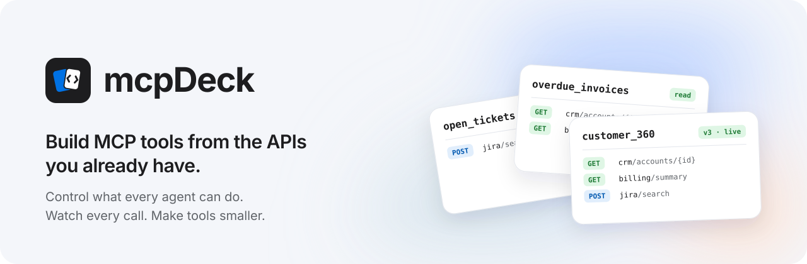

<div align="center">

<picture>
  <source media="(prefers-color-scheme: dark)" srcset="docs/assets/banner-dark.svg">
  
</picture>

<br>

[](LICENSE)
[](https://github.com/abhijeet-oxide/mcpDeck/releases/latest)
[](https://github.com/abhijeet-oxide/mcpDeck/actions/workflows/release.yml)


**[Quickstart](#quickstart)** · **[Benchmark](#benchmark)** · **[Auth](#auth-for-real-systems)** · **[For agents](#for-agents)** · **[Lint](#lint)** · **[Security](#security)** · **[Install](#install)** · **[Status](#status)**

</div>

<br>

# Code Mode for your own APIs, locally

mcpDeck turns the APIs you already have (OpenAPI, Swagger 2.0, Postman, a
pasted curl command) into small MCP tools that each do one job. A tool is a
short TypeScript function that chains the calls, keeps the fields that matter
and returns the answer. The agent makes one call instead of five and reads a
few hundred tokens instead of thousands. mcpDeck runs as one binary on your
machine. Your credentials stay in it, encrypted, and agents never see them.

- **Tools for tasks, not endpoints.** Log in, list, pick, fetch details, trim:
  one tool call for the agent. <!-- C1 -->
- **The auth real systems use.** Login chains with captured tokens, refresh,
  OAuth 2.0, HMAC signing, mutual TLS, a company CA. <!-- C2 -->
- **Agents can set it all up.** What you do in the UI you can also do from the
  CLI and from an admin MCP server, and a person still approves anything that
  writes. <!-- C3 -->
- **Read-only means read-only.** A read agent can't run a write tool, and the
  proxy refuses its writes whatever a tool tries. <!-- C4 -->

> [!NOTE]
> mcpDeck is early: releases are `0.x` and ship on every change to `main`.
> In the UI an imported API is called an *application*.

## Quickstart

```sh
mcpdeck dev        # a demo with mock APIs, toolkits and agents, in temporary data
mcpdeck            # your own instance; the UI opens at http://127.0.0.1:47800
```

The same setup from a terminal, against the public Swagger Petstore (any key
works there). Each line is one step of what the UI does: <!-- C5 -->

```sh
mcpdeck import https://petstore3.swagger.io/api/v3/openapi.json --api petstore
echo special-key | mcpdeck secret set petstore apiKey     # stored encrypted
mcpdeck toolkit create pets --apis petstore
mcpdeck tool generate pets --from petstore.findPetsByStatus --name find_pets
mcpdeck lint pets                                         # best-practice findings, with fixes
mcpdeck connect claude --toolkit pets                     # or: vscode, cursor, claude-desktop
```

`connect` creates an agent token and prints the exact command or config for
that client. Ask the agent for available pets and it calls `find_pets`
through mcpDeck, which adds the key on the way out. <!-- C6 --> A finished
version of this tool, with a test, is in
[examples/petstore](examples/petstore).

## A tool is one file

This is the scanner tool from the [benchmark](#benchmark). `anchore` is an
imported API, and each of its requests is a typed async function.
Credentials come from the API's auth settings, never from the tool.

```ts
export const tool = {
  name: "find_fixable_criticals",
  description: "Critical OS vulnerabilities of one image that have a fix, highest CVSS first: CVE, package and fixed version.",
  useWhen: "Someone asks what to patch in an image",
  inputSchema: {
    type: "object",
    properties: { image_tag: { type: "string", description: "Full tag, e.g. docker.io/library/nginx:1.27" } },
    required: ["image_tag"],
  },
};

export default async function (input) {
  const imgs = await anchore.listImages({});
  const im = imgs.items.find((i) => i.image_detail[0].full_tag === input.image_tag);
  if (!im) throw new Error("No image tagged " + input.image_tag + "; check the full tag including the registry");
  const v = await anchore.getImageVulnerabilitiesByType({ image_digest: im.image_digest, vtype: "os" });
  return v.vulnerabilities
    .filter((x) => x.severity === "Critical" && x.fix !== "None")
    .sort((a, b) => b.nvd_data[0].cvss_v3.base_score - a.nvd_data[0].cvss_v3.base_score)
    .map((x) => ({ cve: x.vuln, pkg: x.package_name, fix: x.fix }));
}
```

Tools run in a sandbox with no file or network access of their own. The API
clients are the only way out, and every call goes through one proxy that adds
credentials, enforces access and records the call. <!-- C7 -->

## Benchmark

There are two ways to give an agent the same two mock systems, an image
scanner and a Jira-like tracker from [`e2e/mockenv`](e2e/mockenv):

- one generated MCP tool per read endpoint that returns the whole response,
  as OpenAPI-to-MCP generators do;
- one mcpDeck task tool per question.

The count covers what the agent reads: server instructions, `tools/list`
and every tool result, in `cl100k_base` tokens. <!-- C9 -->

| Question | Endpoint tools | Task tools | Saving |
|---|---:|---:|---:|
| Which critical OS vulnerabilities in nginx:1.27 have a fix? (2 calls vs 1) | 10,632 | 742 | 93% |
| What is open in the OPS project? (1 call each) | 9,091 | 1,211 | 87% |

Run `make bench` to reproduce it. The raw output is
[`bench/results.json`](bench/results.json), and every CI run checks that the
committed numbers still reproduce, within 2%.

Each mock API has only a handful of endpoints. A real scanner or Jira has
hundreds, which makes the endpoint-per-tool list longer, not shorter. This
measures token volume only, not answer quality.

## Auth for real systems

Auth is set once per API, in the UI, with `mcpdeck auth set`, or from the
admin MCP server. Tools never handle credentials. <!-- C10 -->

| Pattern | How |
|---|---|
| Login request that returns a token or cookie | Login steps with captures (`{{login.access_token}}`). Reused across calls; renewed with a refresh token or a fresh login on expiry, a 401 or a redirect to the login page <!-- C11 --> |
| Login form with a CSRF token and session cookie | A two-step chain: fetch the form, capture the token, post it <!-- C12 --> |
| OAuth 2.0 | Client credentials and password grants, client secret in basic or body, refresh-token rotation <!-- C13 --> |
| API keys, bearer, basic | Header or query; imported from the spec's security schemes or from curl <!-- C14 --> |
| HMAC-signed requests | A string to sign built from method, path, query, timestamp, nonce and body hash; SHA-1, SHA-256 or SHA-512; hex or base64 <!-- C15 --> |
| Mutual TLS and private CAs | Client certificate and key per API, extra CA certificates, or skip verification for a self-signed lab server <!-- C16 --> |

Each of these has scenarios <!-- C17 -->:

- GraphQL, SOAP and XML
- `text/plain` bodies and file downloads
- `202 Accepted` polling
- cursor, page, offset and `Link`-header pagination
- retries on 429 and 503 with `Retry-After`

## For agents

**Agents that use tools.** They connect to `/mcp/<toolkit>`.
- **What they see:** finished tools with read and write annotations, plus
  `search_tools`, `request_tool` and `report_field_usage`.
- **Context cost:** for a one-tool toolkit, server instructions plus
  `tools/list` measure about 470 tokens, and a scenario fails above 1,000.
  <!-- C18 -->
- **Large toolkits:** with more than 25 tools, the 15 most used are listed and
  `search_tools` with `use_tool` reach the rest. <!-- C19 -->
- **Asking for a tool:** `request_tool` records a need for a person to see and
  grants nothing. <!-- C20 -->
- **Large results:** a result over 20,000 tokens is cut to valid JSON, with a
  note saying how much was left out. <!-- C21 -->

**Agents that build tools.** They get `/mcp/<toolkit>/build`, where they
search and describe the APIs, run requests and scripts, and test and save
tools. New read tools go live when they pass the toolkit's rules; tools that
write wait for a person. <!-- C22 -->

**Agents that set mcpDeck up.** They run the admin MCP server on stdio:

```json
{ "mcpServers": { "mcpdeck-admin": { "command": "mcpdeck", "args": ["mcp", "--agent", "Claude Code"] } } }
```

- **Tools:** 19, covering import, variables, secrets, auth, TLS, requests,
  toolkits, tools, tests, lint, reviews and connect.
- **Context cost:** about 1,950 tokens with its instructions; a scenario fails
  above 2,500.
- **What it can do:** onboard a login API end to end, with no UI.
- **What it can't do:** approve its own write tools, widen access, or read
  secret values. For a secret, it reads one from its own environment or asks
  you to type it in the UI.
- **Audit:** its actions are logged under its name. <!-- C23 -->

The full table of which surface can do what is in
[docs/agents.md](docs/agents.md). Coding agents working on mcpDeck itself
start from [`llms.txt`](llms.txt), [`AGENTS.md`](AGENTS.md) and
`mcpdeck help --json`.

## Lint

Every tool is checked as you type, on save, by `mcpdeck lint` and by the
admin MCP `lint` tool. Each rule has a severity, an explanation, a fix and a
source, such as the MCP specification or Anthropic's
[Writing effective tools for agents](https://www.anthropic.com/engineering/writing-tools-for-agents).

Only clear violations block a save:
- an input schema the spec rejects
- a credential in a tool file or as an input
- a write tool marked read-only

Everything else is a warning or a hint. <!-- C24 --> See
[docs/lint-rules.md](docs/lint-rules.md).

```text
$ mcpdeck lint pets
warn  required find_pets: No required parameters
      fix: List the parameters the tool can't work without in required.
      why: https://www.anthropic.com/engineering/writing-tools-for-agents
hint  enum find_pets: status has no enum
      fix: Add enum: [...] with the accepted values.
      why: https://www.anthropic.com/engineering/writing-tools-for-agents
0 blocking, 1 warning, score 95/100, tools/list 303 tokens.
```

## Security

- **Credentials:** agents never receive them, and tool code can't read them.
  Tests send a canary secret through tools, the builder and an echo endpoint,
  and fail if it appears in any output or recorded call. <!-- C25 -->
- **Encryption:** secrets are encrypted with AES-256-GCM. The key is kept in
  your OS keychain. Where there is no keychain, such as a headless Linux box,
  it goes in a file only you can read, and mcpDeck says so when it starts.
  <!-- C26 -->
- **Network:** the server listens on `127.0.0.1` and checks `Host` and
  `Origin`, and the UI opens through a one-time launch link. <!-- C27 -->
- **Audit:** every change and approval goes into an audit log that detects
  edited rows. <!-- C28 -->

mcpDeck controls what agents can do through MCP. It doesn't sandbox the agent
itself: any program running as you, including an agent with a shell, can use
your keychain or call an API directly. Agent tokens sit in plain text in each
client's config, as MCP clients require; revoke a token if it leaks.

## Install

**macOS and Linux**:

```sh
curl -fsSL https://github.com/abhijeet-oxide/mcpDeck/releases/latest/download/install.sh | sh
```

**Windows** (PowerShell, no admin needed):

```powershell
irm https://github.com/abhijeet-oxide/mcpDeck/releases/latest/download/install.ps1 | iex
```

Both check the download against the release checksums and install a single
file for your user. <!-- C29 --> To pin a version, set
`MCPDECK_VERSION=v0.1.0`; to choose the folder, set `MCPDECK_INSTALL_DIR`.

Every release on [Releases](https://github.com/abhijeet-oxide/mcpDeck/releases)
also has:
- plain binaries (`mcpdeck_<os>_<arch>`) and archives
- `checksums.txt`
- an SBOM
- build provenance

Binaries aren't code-signed yet, so Windows SmartScreen may ask you to
confirm. Homebrew, Scoop and container images aren't published.

From source: `make build && ./bin/mcpdeck dev`.

## Status

Everything above works today and has tests. Not built yet:

- Digest auth, multipart and binary request bodies
- Team server mode (Postgres, SSO, roles) and external vaults
- Per-person credentials, so calls run as the person behind the agent
- WSDL, HAR, Bruno and Insomnia import
- Putting existing MCP servers behind the same access rules and call log

## Docs

[Requirements](docs/requirements.md) · [Design](docs/design.md) ·
[UI](docs/ui.md) · [Agents](docs/agents.md) · [Lint rules](docs/lint-rules.md) ·
[Testing](docs/testing.md) · [Releasing](docs/releasing.md) ·
[Claims and their tests](docs/claims.md)

## Contributing

See [CONTRIBUTING.md](CONTRIBUTING.md). In short: start from a requirement,
write the failing test first, then run `make test` and `make lint`. Every
claim in this README links to a test in [docs/claims.md](docs/claims.md),
and CI fails when one doesn't.

## License

[Apache 2.0](LICENSE)
