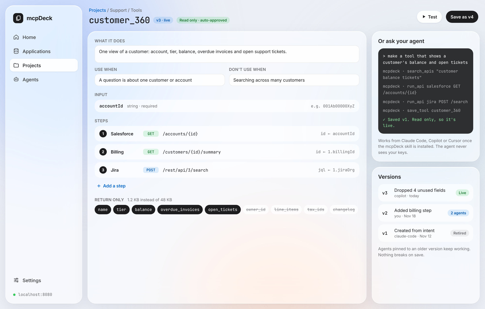
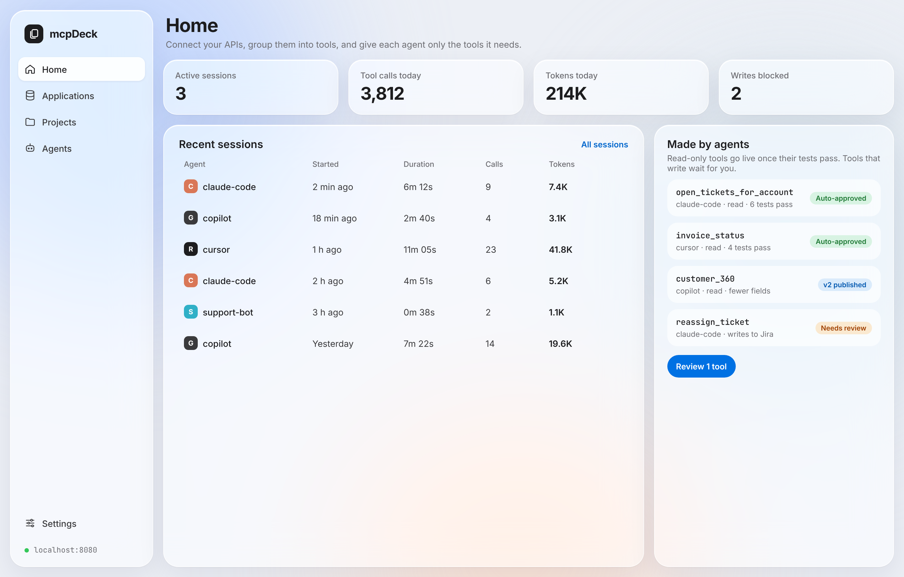
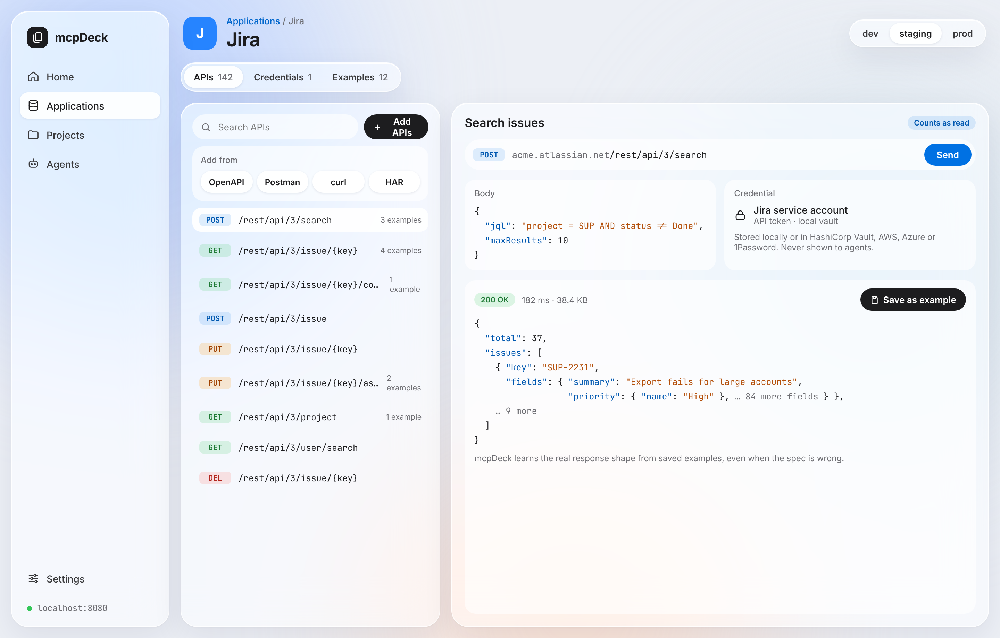
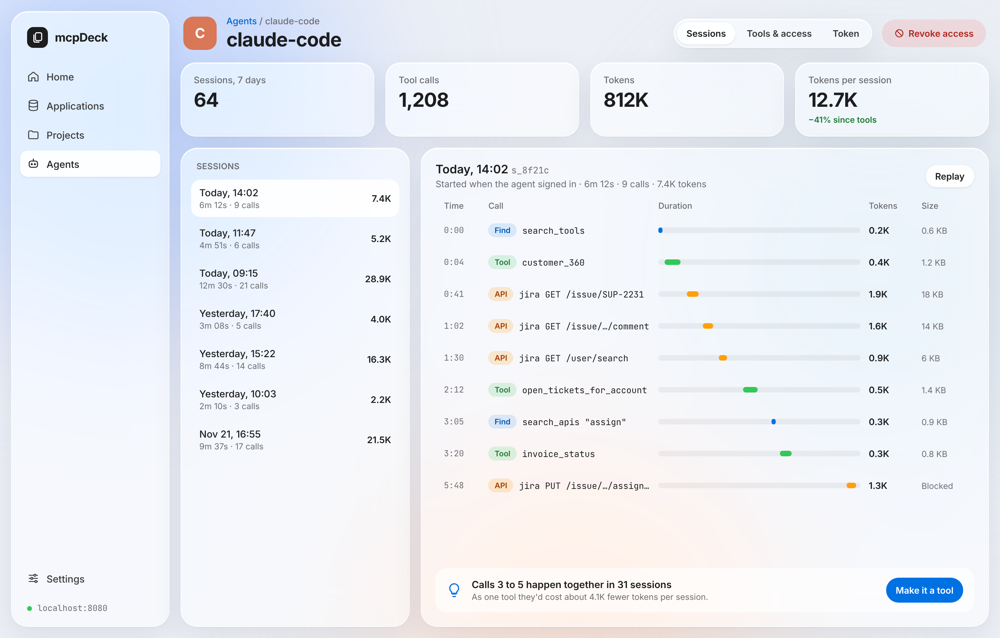
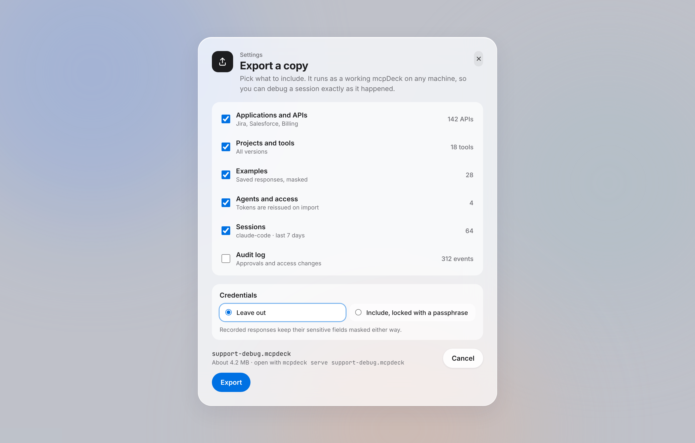

<div align="center">


# mcpDeck

**A repeatable, controlled layer between AI agents and your APIs.**

Turn any API into versioned agent tools. No MCP server to write, no redeploys,<br>
and agents never see a real credential.

[](LICENSE)


[Why](#why-this-exists) · [What it does](#what-mcpdeck-does) · [Quickstart](#quickstart) · [Docs](docs/) · [Status](#status)

<br>



</div>

<br>

## Why this exists

**MCP servers are slow to build and slower to maintain.** Every tool is code you
write, build and deploy. When the API changes or a description needs a tweak,
you redeploy again. Most teams end up with a few hand-built servers that fall
behind the APIs they wrap.

**Legacy systems don't speak MCP.** The internal services, vendor APIs and SOAP
endpoints where the real work happens have a spec at best. Nobody is going to
write and maintain an MCP server for each one.

**Code execution works, but it's ambiguous and hard to audit.** Letting an agent
write code against your APIs gets things done. But the code is different every
run, nobody reviews it, it's gone when the session ends, and afterwards it's hard
to say what actually ran or why.

## What mcpDeck does

mcpDeck sits between your agents and your APIs and makes their work repeatable.

<table>
<tr>
<td width="50%" valign="top">

**Build capabilities from APIs you already have**<br>
Import OpenAPI, Postman or curl. Chain calls into one tool, even across
products: one `customer_360` tool can read Salesforce, Billing and Jira.

</td>
<td width="50%" valign="top">

**Change tools without redeploying**<br>
Every save is a new version and goes live straight away. Agents pinned to an
older version keep working.

</td>
</tr>
<tr>
<td valign="top">

**Agents never see real credentials**<br>
Keys stay in the vault (local, HashiCorp Vault, AWS, Azure, 1Password) and are
added to the request on the way out.

</td>
<td valign="top">

**Decide what each agent can do**<br>
Read-only, read and write, or "this action needs a person to approve".
Revoke access in one click.

</td>
</tr>
<tr>
<td valign="top">

**Let agents build tools safely**<br>
Inside those limits an agent can find APIs, try them and save what works.
Read-only tools can be approved automatically. Tools that write wait for you.

</td>
<td valign="top">

**Trace every call**<br>
Each agent sign-in is a session. See every tool call with its time and tokens,
and spot the calls that should become one tool.

</td>
</tr>
<tr>
<td valign="top">

**Audit everything**<br>
An append-only log records which agent used which tool, when, with what
result, and who approved it.

</td>
<td valign="top">

**Works with any coding agent**<br>
Connect Claude Code, Copilot or Cursor. Use them to build tools, tune them using
session data, or review the audit log.

</td>
</tr>
</table>

## How it fits together

```
Application ─▶ APIs ─▶ Credentials ─▶ Examples
  (Jira)      (import)   (vault)      (saved responses)
                     │
                     ▼
            Project ─▶ Tools        one or more APIs, versioned
                     │
                     ▼
            Agent ─▶ Access         read · read+write · needs approval
                     │
                     ▼
            Session ─▶ calls · time · tokens ─▶ audit log
```

<details>
<summary><b>Screenshots</b></summary>
<br>

| | |
|---|---|
|  |  |
| **Home:** live sessions and tools made by agents | **Application:** import APIs, run them, save examples |
|  |  |
| **Agent:** every session, call, duration and token count | **Settings › Export:** take a working copy anywhere |

</details>

## Quickstart

> mcpDeck is in the design phase. This is how it will work.

```sh
brew install mcpdeck
mcpdeck serve                 # UI + MCP on http://localhost:8080
mcpdeck connect claude        # or: copilot, cursor
```

Then ask your agent:

> make a tool that shows a customer's balance and open Jira tickets

It searches your APIs, runs them with credentials it never sees, and saves
`customer_360` as v1. The tool, its versions and every call it makes show up
in the UI.

Want to try it without real APIs? `mcpdeck dev` starts mcpDeck with mock CRM,
billing and ticketing apps already set up.

## Status

Design phase. Built in this order:

1. Applications, API import, runner, examples
2. Vault, agents, access, proxy
3. Sessions and audit log
4. MCP server and agent skill
5. Tool builder and versions
6. Approval rules
7. Export / import

Read [`docs/requirements.md`](docs/requirements.md) for the full list and
[`docs/design.md`](docs/design.md) for the architecture and stack.

## Contributing

We work test-first. Start with [`AGENTS.md`](AGENTS.md) (also what Claude Code,
Copilot and Cursor read) and [`docs/testing.md`](docs/testing.md).

```sh
make dev     # Go backend + React UI with hot reload
make test    # everything
make build   # one binary: ./bin/mcpdeck
```

## License

[Apache 2.0](LICENSE)
