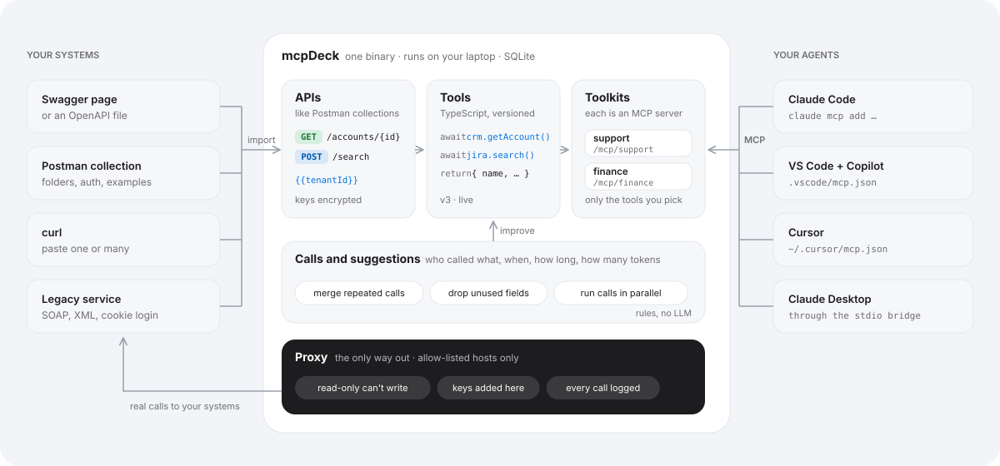

<div align="center">


# mcpDeck

### Build MCP tools from the APIs you already have. Control what every agent can do.

[](LICENSE)


[Why](#why) · [Features](#features) · [How it works](#how-it-works) · [Install](#install) · [Roadmap](#roadmap) · [Docs](docs/)

<br>

<picture>
  <source media="(prefers-color-scheme: dark)" srcset="docs/assets/how-it-works-dark.svg">
  
</picture>

</div>

## Why

- **Building MCP servers is slow.** Every tool is code. A changed description,
  a new field or a fixed bug means another build and another deploy.
- **Legacy systems don't have MCP servers.** Internal services, vendor APIs and
  SOAP endpoints have a spec at best, often just a Postman collection or a
  curl command. Nobody writes and maintains a server for each one.
- **Generated servers are rarely good tools.** OpenAPI-to-MCP generators
  (FastMCP, Stainless, Speakeasy, Postman's MCP generator) are a quick start,
  but by default you get one tool per endpoint and full responses, the agent
  needs several calls for one answer, and every change is a regenerate and
  redeploy. Without a spec, there's nothing to generate from.
- **Integration platforms stop at their catalog.** Zapier MCP, Composio and
  Arcade cover popular SaaS apps well. Your internal and legacy systems aren't
  in the catalog, and adding them means writing integration code.
- **Gateways need a server to start with.** MCP gateways (Docker MCP Gateway,
  Kong) route and secure MCP servers you already have. They don't create tools
  for systems that have none.
- **Letting the agent write code doesn't stick.** It works, then the code is
  gone. Next session it's written again, a little differently, nobody reviews
  it, and the keys sit in its environment.
- **There's no one place to control agents.** Every agent gets the same
  credentials and every tool, including the ones that delete things, and
  nobody can say which agent did what.

## What mcpDeck is

mcpDeck makes it easy to build MCP tools from any HTTP API, and to keep them
small and fast based on how agents actually use them. It's also the one place
that holds the credentials and decides what each agent can do: which tools,
read-only or read and write, all recorded.

One binary, on Windows, macOS or Linux. Your data stays on your machine.

## Features

<table>
<tr>
<td width="50%" valign="top">

#### Bring any API
Import a Swagger page, an OpenAPI file, a Postman collection or curl, or add
requests by hand. It works like Postman: environments, `{{variables}}`, auth,
Send. XML bodies, form posts and cookie logins work for older systems.

</td>
<td width="50%" valign="top">

#### Tools in a few lines of TypeScript
Chain requests across systems, run them in parallel, return only what the
agent needs. Every API you add has autocomplete, down to response fields.
Fill known values like tenant or region from variables instead of asking the
model.

</td>
</tr>
<tr>
<td valign="top">

#### Change it in seconds
Test against a real or saved response, save, and it's live as a new version.
Nothing to build or deploy. Agents pinned to an older version keep working.

</td>
<td valign="top">

#### One MCP server per toolkit
Group tools into toolkits. Each is its own MCP server, added to Claude Code,
VS Code, Cursor or Claude Desktop from the UI or with one command. An agent
sees only the toolkits it's given.

</td>
</tr>
<tr>
<td valign="top">

#### Central credentials, separate agents
Keys are stored once, encrypted, and added to requests on the way out. Agents
share them without ever holding them, while access and history stay separate
per agent. Revoke an agent in one click.

</td>
<td valign="top">

#### Read-only means read-only
Give an agent read access and the proxy refuses POST, PUT, PATCH and DELETE,
whatever a tool tries to do. Tools that write aren't even listed for it.

</td>
</tr>
<tr>
<td valign="top">

#### Agents build, and share
An agent missing a tool can ask for one, or build it if you allow that. New
tools go live when they pass your approval rules (read-only, tested, small
output), and every agent using that toolkit gets them. Tools that write
always wait for you.

</td>
<td valign="top">

#### Every call recorded, then improved
Which agent called which tool, when, with what input, how long it took and
how many tokens it returned. mcpDeck turns that into suggestions, using plain
rules: merge calls that always happen together, trim large outputs, run
independent calls in parallel.

</td>
</tr>
</table>

## How it works

**1. Add an API.** Point mcpDeck at a Swagger page, or import a file:

```sh
mcpdeck import https://petstore3.swagger.io/api/v3/openapi.json
```

**2. Write a tool.** One file. `crm`, `billing` and `jira` are APIs you've added:

```ts
export const tool = {
  name: "customer_360",
  description: "One customer: account, balance, overdue invoices and open tickets.",
  inputSchema: { type: "object", properties: { accountId: { type: "string" } }, required: ["accountId"] },
};

export default async function (input: Input) {
  const account = await crm.getAccount({ id: input.accountId });
  const [summary, tickets] = await Promise.all([
    billing.getCustomerSummary({ id: account.billingId }),
    jira.searchIssues({ body: { jql: `org = "${account.jiraOrg}" AND status != Done` } }),
  ]);
  return {
    name: account.name,
    balance: summary.balance,
    overdueInvoices: summary.invoices.filter((i) => i.overdue),
    openTickets: tickets.issues.map((t) => t.key),
  };
}
```

Three systems, one call for the agent. The keys are added by mcpDeck; this
code never sees them.

**3. Give it to an agent.**

```sh
mcpdeck connect claude --toolkit support        # or: vscode, cursor, claude-desktop
```

The agent gets read access by default. Give it read and write, or let it
build tools, from the Agents page.

## Install

> [!NOTE]
> mcpDeck is pre-release. These commands work from the first release.

```sh
# macOS, Linux
brew install abhijeet-oxide/tap/mcpdeck

# Windows
scoop bucket add mcpdeck https://github.com/abhijeet-oxide/scoop-bucket
scoop install mcpdeck
```

Or download the binary for your platform from
[Releases](https://github.com/abhijeet-oxide/mcpDeck/releases). Then:

```sh
mcpdeck          # starts and opens http://127.0.0.1:47800
mcpdeck dev      # same, with demo APIs to try it on
```

## Security

- Agents connected over MCP never receive credentials. Tool code can't read
  them either.
- Secrets are encrypted with AES-256-GCM. The key lives in your OS keychain
  (Windows Credential Manager, macOS Keychain, Secret Service), not in the
  database.
- The server listens on `127.0.0.1` only and refuses requests from web pages.
- Every change and approval goes into an append-only audit log.

mcpDeck controls what agents can do through MCP. It doesn't sandbox the agent
itself: a program running as you on the same machine can use your keychain
or call an API directly.

## Roadmap

**First release: on your machine**
- APIs: Swagger page, OpenAPI, Postman and curl import; environments,
  variables, auth (including login requests); runner, history, examples
- Encrypted credential store
- TypeScript tools with autocomplete, tests and versions; tools as files
- Toolkits as MCP servers; one-step setup for Claude Code, VS Code, Cursor,
  Claude Desktop
- Agents with read or read+write access, building permission and revoke
- Tool requests, approval rules, publishing to every agent in a toolkit
- Call log, usage and suggestions

**After that: for teams**
- Server mode with Postgres, SSO and roles
- External vaults: HashiCorp Vault, AWS, Azure, GCP, 1Password
- Visual tool builder
- Per-person credentials, so calls run as the person behind the agent
- More imports: WSDL, HAR, Bruno, Insomnia
- Existing MCP servers behind the same access rules and call log

## Docs

[Vision](docs/vision.md) · [Requirements](docs/requirements.md) ·
[Design](docs/design.md) · [Testing](docs/testing.md)

## Contributing

We work test-first. Start with [`AGENTS.md`](AGENTS.md), which Claude Code,
Copilot and Cursor also read.

```sh
make dev     # Go backend + React UI with hot reload
make test    # all tests
make build   # one binary: ./bin/mcpdeck
```

## License

[Apache 2.0](LICENSE)
