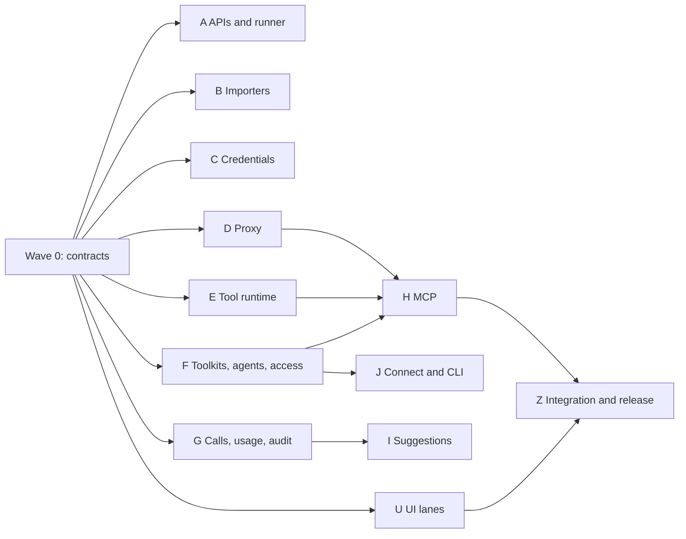

# Build plan

Phase 1 as work packages that several agents can build at the same time. Each package
says what it owns, what it needs first, which requirements it covers and how
we know it's done. Every Phase 1 requirement in [requirements.md](requirements.md)
belongs to exactly one package.

How the work is split:

- **Contracts first.** Wave 0 fixes the schema, the Go interfaces, the HTTP API
  (OpenAPI) and the UI shell. After that, backend and UI lanes build against
  those contracts and don't wait for each other: UI lanes use a mock server
  generated from the OpenAPI document, and backend lanes use the fakes that
  come with each interface.
- **One owner per path.** A package edits only the paths it lists. If it needs
  a contract change (a column, an interface method, an endpoint), it opens a
  small PR against the contract file first, tagged `contract`. That PR merges
  before the package's own PR.
- **Same rules as any change.** Test first with `// REQ: <ID>`, invariants
  untouched, `make test lint` green. See [AGENTS.md](../AGENTS.md).

## How to run it with agents

1. One agent takes Wave 0, in order. It's short and everything else depends on it.
2. Then start one agent per lane in Wave 1. Each takes its packages from the
   top, and moves to the next once the PR is merged.
3. Give each agent this file, the package ID and its lane. A prompt that works:

   ```
   Build work package WP-B2 from docs/build-plan.md on a new branch wp/b2.
   Read AGENTS.md first. Only edit the paths the package owns. Write failing
   tests tagged with the requirement IDs, make them pass, run make test lint,
   and open a PR titled "WP-B2: <title>" that lists the requirements covered.
   ```

4. Merge in dependency order. A package whose dependencies aren't merged
   works against the contract's fake and rebases when they land.
5. The integration lane (Z) runs end-to-end flows as packages merge and
   files issues against the lane that owns a failure.



## Wave 0: contracts (one agent, in order)

| ID | Package | Owns | Covers | Done when |
|---|---|---|---|---|
| **WP-01** | Repo skeleton | `cmd/mcpdeck/main.go`, `internal/clock`, `internal/version`, `go.mod`, CI wiring | RUN-1 (build matrix), NFR-4 (Windows CI), NFR-6 | `make build` produces a binary on all six targets in CI; `mcpdeck version` prints build info; Windows runner green |
| **WP-02** | Schema | `internal/store/migrations`, `internal/store/queries`, `sqlc.yaml` | RUN-3 | Every table in [design.md](design.md#data-model) migrates up on a temp dir; sqlc generates; a store test round-trips one row per table |
| **WP-03** | Interfaces and fakes | `internal/*/iface.go` and `fake.go` for proxy, vault, tool runtime, session recorder, keychain, client config, browser open | — | Each interface has a fake used in at least one test; `go vet` clean; packages import interfaces, not each other |
| **WP-04** | HTTP API contract | `internal/server/openapi.yaml`, generated TS client in `web/src/lib/api` | RUN-6 | Every UI action in [ui.md](ui.md) maps to an operation; client generates; a mock server (MSW) serves the demo world from the document's examples |
| **WP-05** | UI shell | `web/src/app`, `web/src/styles/tokens.css`, `web/src/components` | UI-2, UI-3, UI-7, UI-8, UI-9 | Sidebar, page header, tabs, chips, buttons, copy field, prompt card, modal, drawer and toast match the [mockup](mockups/index.html) in light and dark; fonts bundled; axe has no violations |
| **WP-06** | Demo world | `internal/mock`, `examples/demo` | MOCK-1, MOCK-3 | `acme-crm`, `acme-billing`, `acme-support`, `acme-legacy` serve seeded, consistent data on :9001–:9004, including the cookie login and the bloated billing responses |

## Wave 1: lanes in parallel

### Lane A: APIs and runner (backend)

| ID | Package | Owns | Needs | Covers | Done when |
|---|---|---|---|---|---|
| WP-A1 | APIs, folders, requests | `internal/api` | 02, 03 | APP-1, HTTP-1, API-1 | CRUD through the HTTP API; delete refused while tools use it; read/write classification and the "check access" flag table-tested |
| WP-A2 | Environments and variables | `internal/api/vars` | A1 | ENV-1, VAR-1, VAR-2 | Scope order and `{{var}}` resolution golden-tested; `.env` change picked up on next call; unresolved vars listed |
| WP-A3 | Runner, history, copy as | `internal/api/runner`, routes | A2, D1 | RNR-1, RNR-2, RNR-3 | Send goes through the proxy and lands in history; copy as curl/fetch/tool call snapshot-tested; credentials never in copies |
| WP-A4 | Examples and captured schema | `internal/api/examples` | A3 | EX-1, EX-2 | Masking list applied before storage; schema merged across examples and diffed against the spec |
| WP-A5 | Scripts | `internal/api/scripts` | A3, E1 | RNR-4, RNR-5, RNR-6 | The fixture Postman collection's tests give the same results as in Postman; imported scripts don't run until trusted |

### Lane B: Importers (pure functions)

| ID | Package | Owns | Needs | Covers | Done when |
|---|---|---|---|---|---|
| WP-B1 | OpenAPI and Swagger | `internal/importer/openapi` | 02 | IMP-1 | Golden files for at least five public specs, one Swagger 2.0 |
| WP-B2 | Swagger and Redoc pages | `internal/importer/page` | B1 | IMP-2 | Finds the spec on default Swagger UI and Redoc pages; clear message otherwise |
| WP-B3 | Postman | `internal/importer/postman` | 02 | IMP-3 | v2.1 collections and environments: folders, variables, auth, examples, scripts marked untrusted |
| WP-B4 | curl | `internal/importer/curl` | 02 | IMP-4 | Multiple commands; credential headers and query keys moved to a credential, never on the request |
| WP-B5 | Import command and route | `internal/importer/apply.go` | A1, B1–B4 | CLI-1 (`import`) | `import <src> --api <name>` adds and updates, never deletes; prints what changed; same through the HTTP API |

### Lane C: Credentials

| ID | Package | Owns | Needs | Covers | Done when |
|---|---|---|---|---|---|
| WP-C1 | Local vault | `internal/vault` | 03 | CRED-2, CRED-5, CRED-6 | AES-256-GCM per value; key only in the keychain (fake in tests, each OS backend behind the interface); key-file fallback warns |
| WP-C2 | Auth types and login request | `internal/vault/auth` | C1, D1 | AUTH-1, CRED-1 | Inheritance table-tested; the legacy mock's cookie login works through a tool with no login code |
| WP-C3 | Canary suite | `internal/vault/canary_test.go`, `e2e/canary` | C1, then every lane | CRED-4, CRED-7, CRED-8 | Seeded canary secrets appear in no response, log, row, error or MCP output; runs in CI on every PR |

### Lane D: Proxy

| ID | Package | Owns | Needs | Covers | Done when |
|---|---|---|---|---|---|
| WP-D1 | Outbound path | `internal/proxy` | 03 | APP-2, NFR-2 | Only package with an upstream `http.Client` (lint rule); allowed hosts enforced; overhead benchmark under budget |
| WP-D2 | Grants at the proxy | `internal/proxy/grant.go` | D1, F2 | ACC-2 | Methods × access × overrides table: every write refused for read grants, with the MCP-4 message |
| WP-D3 | Recording hook | `internal/proxy/record.go` | D1, G1 | SES-2 (upstream) | Every upstream call recorded with parent call, masked bodies, size |

### Lane E: Tool runtime

| ID | Package | Owns | Needs | Covers | Done when |
|---|---|---|---|---|---|
| WP-E1 | Sandbox | `internal/tool/sandbox` | 03 | TOOL-4, TOOL-6 | Escape suite passes (filesystem, network, prototype pollution, loops, memory, recursion, ReDoS, huge strings); limits enforced |
| WP-E2 | Runtime globals and typegen | `internal/tool/runtime`, `internal/tool/typegen` | E1, A1 | TOOL-1, TOOL-2, TOOL-9 | The TOOL-1 example runs on the demo world; `.d.ts` generated per API; `vars` never in `tools/list` |
| WP-E3 | Test runs and tests | `internal/tool/test` | E2, D1 | TOOL-5, TOOL-7, TOOL-8 | Run against examples (no network) or an environment; per-call timeline and sizes; `pm.test` cases saved and run on save |
| WP-E4 | Versions | `internal/tool/version` | E2 | VER-1, VER-2, VER-3, VER-4 | Immutable versions; pins honoured; breaking change detected; diff and roll back |
| WP-E5 | Create from requests | `internal/tool/generate` | E2 | TOOL-10 | Golden tests: data flow wired, independent calls in `Promise.all`, ticked fields returned |
| WP-E6 | Tools as files | `internal/tool/files` | E4 | FILE-1 | pull → edit → `tsc --noEmit` → push creates a version |

### Lane F: Toolkits, agents and access

| ID | Package | Owns | Needs | Covers | Done when |
|---|---|---|---|---|---|
| WP-F1 | Toolkits and library | `internal/toolkit` | 02 | TOOL-11, TK-1, TK-4 | Tool in two toolkits shares versions; build scope limits what build tools reach |
| WP-F2 | Agents and grants | `internal/agent` | 02 | AGT-1, AGT-2, AGT-4, AGT-5 | Token shown once, stored hashed; revoke ends sessions within 1 s; rotate |
| WP-F3 | Approval rules | `internal/toolkit/approval` | F1, E3 | AB-1, AB-2, AB-3, AB-5, AB-6 | Rule-combination table → live or pending; write tools always pending; approval with an agent token refused |
| WP-F4 | Requests, feedback, per-agent output | `internal/toolkit/feedback` | F2, G1 | AB-4, FB-1, FB-2, OUT-1, AB-8 | Requests close when the fulfilling version goes live; reports combined per field; drops applied after the tool runs and before counting |
| WP-F5 | No escalation | `internal/agent/escalation_test.go` | F2, H1 | ACC-6 | Every agent-reachable endpoint tested against the ACC-6 list |

### Lane G: Calls, usage and audit

| ID | Package | Owns | Needs | Covers | Done when |
|---|---|---|---|---|---|
| WP-G1 | Sessions and calls | `internal/session` | 02, 03 | SES-1, SES-2, SES-3, SES-5 | Every call kind recorded; tokens counted with a named encoder on everything returned, including `tools/list`; retention job |
| WP-G2 | Usage | `internal/usage` | G1 | USE-1 | 24 h / 7 d / 30 d aggregates per tool, toolkit and agent match a fixture |
| WP-G3 | Audit log | `internal/audit` | 02 | AUD-1, AUD-2 | Append-only; hash chain; `mcpdeck audit verify` detects an edited row |

### Lane H: MCP

| ID | Package | Owns | Needs | Covers | Done when |
|---|---|---|---|---|---|
| WP-H1 | Endpoint per toolkit | `internal/mcp` | D2, E2, F2, G1 | TK-2, TK-3, MCP-2, ACC-3 | Streamable HTTP at `/mcp/<toolkit>`; stdio bridge; instructions; annotations; least-exposure list over 25 tools |
| WP-H2 | Build tools | `internal/mcp/build` | H1, E3, F3 | MCP-3, MCP-4 | All nine build tools plus `request_tool` and `report_field_usage` through a real MCP client; errors say what to do |
| WP-H3 | Publish and hints | `internal/mcp/notify` | H1 | AB-7, MCP-6 | `list_changed` sent to every connected agent of the toolkit; one hint under 30 tokens on large responses |

### Lane I: Suggestions

| ID | Package | Owns | Needs | Covers | Done when |
|---|---|---|---|---|---|
| WP-I1 | Rule engine | `internal/insight` | G1 | INS-1 | Rules are pure functions over calls; evidence, saving and before/after stored |
| WP-I2 | Rules | `internal/insight/rules` | I1, F4 | INS-2, INS-3, INS-4, INS-5, INS-6, INS-7, INS-8, INS-9, INS-10, INS-11, INS-12 | One golden fixture per rule, including both INS-12 cases |

### Lane J: Connect, skills and CLI

| ID | Package | Owns | Needs | Covers | Done when |
|---|---|---|---|---|---|
| WP-J1 | Client configs | `internal/connect` | F2 | AGT-3 | Claude Code command, VS Code and Cursor install links, config writers for all four clients with backups; written files parse on Windows, macOS and Linux in CI |
| WP-J2 | Skill install | `internal/connect/skills`, `skills/` | J1 | SKL-1, SKL-2 | Installs and updates the four skills per client; touches nothing else |
| WP-J3 | CLI | `cmd/mcpdeck` | B5, J1, F2, E6 | CLI-1, RUN-2, RUN-4, RUN-7 | Every command in CLI-1 with `--help` example and `--json`; second launch opens the running instance; taken port refused with a message |
| WP-J4 | Local server guard | `internal/server/guard.go` | 01 | RUN-5 | Host × Origin × cookie × token table for every route group |
| WP-J5 | Dev mode | `cmd/mcpdeck/dev.go` | 06, H1 | MOCK-2, MOCK-4, MOCK-5 | `mcpdeck dev` prints the mocks and the dev toolkit; fault flags work; recorded session → mock |

### UI lanes

All UI lanes build against the WP-04 mock server, follow [ui.md](ui.md) and the
[mockup](mockups/index.html), and add Playwright tests for their screens.

| ID | Package | Owns | Needs | Covers | Done when |
|---|---|---|---|---|---|
| WP-U1 | Home, first run, palette | `web/src/routes/home`, `web/src/components/palette` | 04, 05 | UI-1, UI-6, UI-10, UI-11 | First-run steps reflect real state; Needs you lists reviews, requests, suggestions; `Ctrl+K` finds and runs everything in the mockup's list |
| WP-U2 | APIs | `web/src/routes/apis` | 04, 05 | UI screens for A1–A5, B5, C1–C2 | Add API dialog with all five sources; Postman-style workspace; environments; credentials write-only; check-access prompt |
| WP-U3 | Toolkits and tool editor | `web/src/routes/toolkits`, `web/src/components/editor` | 04, 05 | TOOL-3 and UI screens for E3–E5, F1, F3–F4 | Monaco with typegen IntelliSense (`crm.` lists requests); test panel with timeline and sizes; versions diff; output fields; review page |
| WP-U4 | Agents and Connect | `web/src/routes/agents`, `web/src/components/connect` | 04, 05 | UI screens for F2, J1–J2 | Connect dialog for all five clients; token shown once; live connection state; grants editable in place; revoke and rotate |
| WP-U5 | Activity | `web/src/routes/activity` | 04, 05 | SES-4 and UI screens for G2–G3, I2 | Calls table with filters, waterfall per session, detail pane; usage; audit with verify; suggestion drawer |
| WP-U6 | Settings | `web/src/routes/settings` | 04, 05 | RUN-7 (UI), CRED-8 (UI) | Every setting persists; theme switch; security text matches the README |

### Lane Z: Integration and release

| ID | Package | Owns | Needs | Covers | Done when |
|---|---|---|---|---|---|
| WP-Z1 | M1 walking skeleton | `e2e/m1` | 01–06, then thin slices of A1, D1, E2, F1, F2, H1, J1, U1–U4 | — | The M1 outcome in requirements.md runs on Linux and Windows CI |
| WP-Z2 | End-to-end suites | `e2e/` | Each milestone | UI-0, UI-4, UI-5 | Every flow done in the UI alone; click-every-control test with no console errors; banned-words check; MCP client flows per milestone |
| WP-Z3 | Release | `.goreleaser.yaml`, `.github/workflows/release.yml` | J3 | NFR-1, NFR-3, NFR-5, NFR-7 | Size, memory and start-time budgets measured per release; zero-config first run; checksums and SBOM published |
| WP-Z4 | Screenshots | `scripts/screenshots`, README | U1–U6 | DOC-1 | `make screenshots` captures the real app on the demo world, light and dark, and replaces mockup images in the README |

## Milestones from packages

Each milestone in requirements.md is done when these packages are merged and
Lane Z's suite for it is green.

| Milestone | Packages |
|---|---|
| M1 Walking skeleton | Wave 0, Z1 (thin slices) |
| M2 APIs | A1–A5, B1–B5, U2 |
| M3 Credentials | C1–C3, D1 |
| M4 Code tools | E1–E6, U3 (editor) |
| M5 Toolkits, agents and access | D2, F1–F5, H1–H3, J1–J5, U1, U3 (toolkit, review), U4 |
| M6 Calls and usage | D3, G1–G3, U5, U6 |
| M7 Suggestions | I1–I2, U5 (suggestions) |

## What can run at the same time

After Wave 0, up to twelve agents can work at once without touching the same
files: A, B, C, D, E, F, G and U1–U5. H, I and J start as their dependencies
merge, usually one or two packages in. The longest chain is
02 → D1 → D2 → H1 → H2 → Z2; keep one agent on it.
